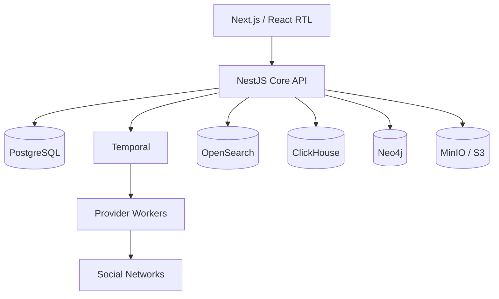

# معماری فنی هادی / محتوا‌یاب

> جزئیات قفل‌شدهٔ استیج S03: [مرزبندی Core/Provider](architecture/CORE_PROVIDER_BOUNDARIES_FA.md)، [استقرار و شبکه](architecture/DEPLOYMENT_NETWORK_MODEL_FA.md)، [پایگاه‌های داده](architecture/DATA_STORES_DECISION_FA.md)، [Threat Model](architecture/THREAT_MODEL_FA.md) و [ADRها](architecture/adr/).

## اصل معماری

سامانه یک **Modular Monolith در Core** و مجموعه‌ای از **Provider Workerهای ایزوله** است. این انتخاب، سرعت MVP را حفظ می‌کند و در عین حال وابستگی‌های ناسازگار شبکه‌ها را از هسته جدا نگه می‌دارد. Providerها حق دسترسی مستقیم به دیتابیس Core ندارند.



## اجزای اصلی

| جزء | فناوری پیشنهادی | مسئولیت |
|---|---|---|
| Web | Next.js، React، TypeScript | پنل ادمین و کاربر، SSR، RTL، PWA اختیاری |
| Core API | NestJS | Auth، Tenancy، RBAC، Accounts، Jobs، Content، Rules، Planner |
| Workflow | Temporal | Backfill، Watch، Retry، Schedule، Transfer و بازیابی پس از قطع |
| Provider Workers | Python یا Bun در Image مستقل | اتصال شبکه، استخراج، دانلود، انتشار و Forward |
| Operational DB | PostgreSQL | منبع حقیقت عملیاتی و مرزبندی Tenant |
| Search | OpenSearch | فارسی، Facet، Highlight، Hybrid Search |
| Analytics | ClickHouse | Snapshot، Trend، گزارش‌های زمانی و تجمیع حجیم |
| Graph | Neo4j | تعامل، انتشار، Community و Entity Resolution |
| Object Storage | MinIO/S3 | رسانه، Thumbnail، Export، Artifact و Lifecycle |
| Cache | Redis | Cache کوتاه، Rate Limit و Pub/Sub کم‌اهمیت؛ نه منبع حقیقت |

## مرز دامنه‌ها

- Identity & Access
- Workspace & Billing
- Provider Registry
- Accounts & Pools
- Sources & Destinations
- Extraction & Watch
- Content Library
- Search & Collections
- Rules & AI
- Transfer & Publishing
- Analytics & Graph
- Audit & Operations

هر دامنه API، مدل داده، Permission و رویدادهای خود را دارد. ارتباط بین دامنه‌ها با ID و Event انجام می‌شود و Joinهای مستقیم کنترل‌نشده ممنوع‌اند.

## قرارداد Provider

عملیات پایه عبارت‌اند از: `health`، `begin_auth`، `complete_auth`، `resolve_source`، `search`، `extract`، `watch`، `fetch_metrics`، `download_media`، `publish` و `forward_native`.

هر درخواست شامل `tenant_id`، `correlation_id`، `idempotency_key` و `deadline` است. خطاها Typed هستند: `AuthRequired`، `RateLimited`، `Challenge`، `Forbidden`، `NotFound`، `InvalidMedia`، `Retryable` و `Fatal`.

## ساختار آتی Monorepo

```text
apps/
  web/                 # Next.js
  api/                 # NestJS
  admin-worker/        # کارهای داخلی Core
packages/
  contracts/           # Schema و Type مشترک
  ui/                  # Design System RTL
  config/              # ESLint, TS, test config
providers/
  telegram/
  instagram/
  eitaa/
  bale/
  ...
infra/
  compose/
  nginx/
  observability/
  migrations/
docs/
roadmap/
```

## سیاست داده

- Raw Content تغییرناپذیر است.
- نسخه‌های ویرایش‌شده Provenance، Rule/Prompt version و تأییدکننده دارند.
- رسانه با Checksum و Provider Asset ID Deduplicate می‌شود.
- Cursor فقط پس از ثبت موفق داده و رسانه‌های لازم جلو می‌رود.
- تمام Queryها و Indexها Tenant-aware هستند.

