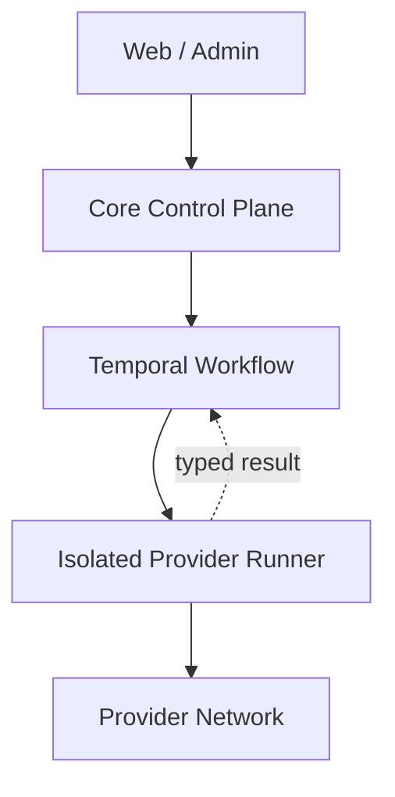

# مرزبندی Core و Provider

> شناسه تصمیم: S03-W01 — وضعیت: پذیرفته‌شده — بازبینی بعدی: S08

## دامنه و معیار پذیرش

این سند مرز مالکیت، قرارداد ارتباط و حالت‌های شکست بین هستهٔ هادی و Adapterهای شبکه‌های اجتماعی را قفل می‌کند. پیاده‌سازی SDK و Contract Test Kit در S08 انجام می‌شود؛ این استیج فقط مرز معماری را الزام‌آور می‌کند.

معیار پذیرش W01: هیچ Provider به دیتابیس، ایندکس، Object Storage یا Provider دیگر دسترسی مستقیم ندارد؛ هر فراخوانی Tenant-aware، نسخه‌دار، قابل لغو، دارای Deadline و Idempotency Key است؛ خروجی با Envelope استاندارد و خطای Typed برمی‌گردد.

## مالکیت مسئولیت‌ها

| قابلیت | مالک Core | مالک Provider Runner |
|---|---|---|
| هویت، Workspace، RBAC و Policy | بله | فقط دریافت Grant کوتاه‌عمر |
| Registry، Capability و Risk Tier | بله | اعلام Manifest امضاشده |
| حساب و Secret Metadata | بله؛ مقدار Secret در Vault | استفادهٔ موقت از Secret Scope شده |
| برنامه‌ریزی Job، Retry و Approval | بله؛ Temporal | اجرای یک Activity و Heartbeat |
| Canonical Content و Provenance | بله | نگاشت Wire Payload به DTO قرارداد |
| Cursor خام Provider | نگهداری رمزگذاری‌شده | تولید و اعتبارسنجی نسخهٔ خودش |
| تماس شبکه، Pagination و Rate Limit | خیر | بله |
| دانلود/آپلود Stream | صدور URL موقت و ثبت Receipt | انتقال Stream و Checksum |
| Search، Analytics و Graph | بله | بدون دسترسی مستقیم |
| Log/Audit | Trace و Audit مرکزی | Telemetry پالایش‌شده، بدون Secret |

## Control Plane و Data Plane



- **Control Plane:** Core API، Policy، Registry، Job، Approval، Audit و وضعیت Canonical.
- **Execution Plane:** Runnerهای Stateless/Replaceable با Task Queue جدا و Egress محدود.
- **Data Plane:** PostgreSQL، MinIO و Projectionها؛ فقط سرویس‌های مالک در Core به آن متصل‌اند.
- Runner هیچ Endpoint ورودی عمومی ندارد و کار را فقط از Task Queue مجاز می‌گیرد.

## قرارداد درخواست و پاسخ

Envelope منطقی زیر در S08 به JSON Schema/TypeScript/Python تبدیل می‌شود:

```json
{
  "contract_version": "1.0",
  "operation": "extract",
  "tenant_id": "ten_...",
  "workspace_id": "ws_...",
  "account_ref": "acc_...",
  "correlation_id": "cor_...",
  "idempotency_key": "idem_...",
  "deadline_at": "2026-11-07T02:00:00Z",
  "policy_snapshot_id": "pol_...",
  "secret_grant_ref": "grant_...",
  "payload": {}
}
```

پاسخ موفق شامل `provider_request_id`، `result`، `next_cursor`، `rate_limit` و `receipts[]` است. پاسخ ناموفق شامل `error.code`، `retryability`، `retry_after`، `safe_message` و `provider_request_id` است؛ Payload خام یا Secret در خطا مجاز نیست.

### خطاهای Typed

| کد | Retry | رفتار Core |
|---|---|---|
| `AUTH_REQUIRED` / `SESSION_REVOKED` | خیر | توقف حساب، اعلان و Re-auth |
| `CHALLENGE_REQUIRED` | دستی | انتقال به Approval/Challenge Flow |
| `RATE_LIMITED` | بله | احترام به `retry_after` و Account Budget |
| `TRANSIENT_NETWORK` | بله | Backoff با Jitter در سقف Deadline |
| `FORBIDDEN` / `NOT_FOUND` | خیر | ثبت Failure امن و ادامه طبق Policy |
| `INVALID_MEDIA` | شرطی | Transform یا Dead Letter |
| `CAPABILITY_UNSUPPORTED` | خیر | رد Plan پیش از اجرا |
| `POLICY_DENIED` | خیر | Audit امنیتی؛ بدون تماس Provider |
| `FATAL_PROVIDER` | خیر | Kill Switch/Quarantine در آستانهٔ تعریف‌شده |

## مسیر انتهابه‌انتها

1. Core مجوز Tenant، Purpose و Capability را ارزیابی و Policy Snapshot را ثابت می‌کند.
2. Workflow با `idempotency_key` پایدار، Deadline و Task Queue اختصاصی Provider آغاز می‌شود.
3. Runner یک Secret Grant کوتاه‌عمر می‌گیرد؛ مقدار Secret هرگز به Workflow History نمی‌رود.
4. Runner با Provider تماس می‌گیرد، Heartbeat/Cursor موقت می‌فرستد و داده را با Schema نسخه‌دار برمی‌گرداند.
5. Core Raw Payload را تغییرناپذیر ثبت، Canonical Mapping و Outbox را در یک تراکنش Commit می‌کند.
6. پس از Commit موفق، Cursor قطعی جلو می‌رود و Projectionها Async به‌روز می‌شوند.

برای انتشار، `dry_run` و Preview قبل از Approval تولید می‌شود؛ سپس Runner Receipt مقصد را برمی‌گرداند. تکرار همان Idempotency Key نباید پست دوم بسازد. Forward بومی فقط وقتی مجاز است که Source و Destination یک Provider، Capability فعال و Policy اجازه‌دهنده داشته باشند.

## امنیت، مجوز و تله‌متری

- Authorization در Core انجام می‌شود؛ Runner تصمیم RBAC مستقل نمی‌گیرد.
- Secret Grant به Tenant، Account، Operation، Runner Image Digest و TTL مقید است.
- C4 شامل رمز، OTP، Cookie، Token و Private Key از Log، Trace، Search، AI و Export حذف می‌شود.
- Spanهای الزامی: `core.plan`، `workflow.dispatch`، `provider.call`، `media.transfer` و `core.commit`.
- Attributeهای مجاز: شناسه‌های opaque، Provider، Operation، Attempt، Duration و Outcome؛ متن پست و Headerهای احراز هویت ممنوع‌اند.
- Metricها: latency، success rate، retry، challenge، rate-limit، bytes و cursor lag به تفکیک Provider و Operation؛ Tenant ID در Metric عمومی Label نمی‌شود.
- Auditهای الزامی: Policy Decision، Secret Grant، Kill Switch، Approval و Publish Receipt.

## قواعد شکست و بازیابی

- Cancel باید از Workflow به Runner منتقل شود؛ Runner Stream را قطع و Artifact موقت را پاک می‌کند.
- نتیجهٔ رسیده بعد از Deadline پذیرفته نمی‌شود، مگر به‌عنوان Evidence تشخیصی بدون Commit دامنه.
- Crash پس از تماس Provider و قبل از Receipt با Reconcile و Lookup Provider حل می‌شود؛ Retry کور برای Publish ممنوع است.
- Poison Message بعد از سقف تلاش به Dead Letter می‌رود و Cursor جلو نمی‌رود.
- Circuit Breaker در سطح Provider/Operation و Kill Switch در سطح Platform قابل فعال‌سازی است.
- ناسازگاری Schema با `CONTRACT_INCOMPATIBLE` Fail-closed می‌شود.

## ممنوعیت‌های صریح

Provider حق ندارد Core DB، OpenSearch، ClickHouse، Neo4j، Redis عمومی، Bucket دائمی، Secret Provider دیگر یا دادهٔ Tenant دیگر را Query کند؛ CAPTCHA/DRM/Access Control را دور بزند؛ Raw Content را ویرایش کند؛ یا بدون Receipt موفقیت اعلام کند.

## منابع مرجع

- [Temporal Durable Execution](https://docs.temporal.io/temporal)
- [OWASP Secrets Management](https://cheatsheetseries.owasp.org/cheatsheets/Secrets_Management_Cheat_Sheet.html)
- [OWASP Logging](https://cheatsheetseries.owasp.org/cheatsheets/Logging_Cheat_Sheet.html)

## معیار پذیرش W01

- مالکیت همهٔ قابلیت‌ها مشخص است.
- Contract Envelope، Typed Error، Idempotency و Cursor Commit تعریف شده‌اند.
- مجوز، Telemetry، Failure و Recovery پوشش دارند.
- مدل ماشین‌خوان `architecture/system-model.json` دسترسی مستقیم Runner به Data Plane را رد می‌کند.
