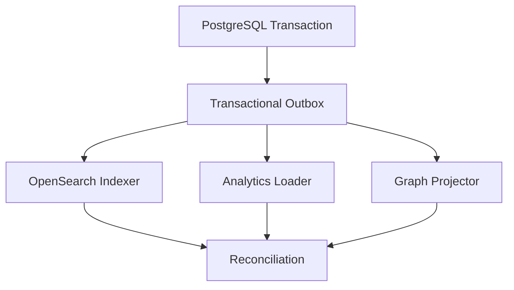

# تصمیم پایگاه‌های داده و مالکیت داده

> شناسه تصمیم: S03-W03 — وضعیت: پذیرفته‌شده — اصل: PostgreSQL منبع حقیقت

## دامنه و معیار پذیرش

این سند جایگاه هر Store، سازگاری، Tenant Isolation، Backup، حذف و شرط ورود فناوری‌های تخصصی را مشخص می‌کند. هدف، Polyglot Persistence کنترل‌شده است؛ نه توزیع زودهنگام داده.

معیار پذیرش W03: برای هر Data Class دقیقاً یک System of Record مشخص است؛ Projectionها قابل Rebuild هستند؛ تراکنش توزیع‌شده نداریم؛ حذف/Retention به همهٔ Storeها و Backupها قابل ردیابی است.

## ماتریس تصمیم

| Store | نقش | System of Record | ورود به Runtime |
|---|---|---:|---|
| PostgreSQL | Tenant، Identity، Account Metadata، Job، Canonical Content، Rule، Plan، Audit Index، Outbox | بله | S04/S06 به بعد |
| Temporal Persistence | Workflow History، Timer، Signal و Retry State | فقط حقیقت Workflow، نه دامنه | S09 |
| MinIO/S3 | Raw Media، Derived Media، Export Artifact با Checksum/Lifecycle | بله برای Binary | S15 |
| Redis | Cache، Rate Limit، Lease کوتاه و Lock با TTL | خیر | فقط پس از نیاز اندازه‌گیری‌شده |
| OpenSearch | جست‌وجو، Facet، Highlight و Vector Projection | خیر؛ Rebuild از PG/MinIO | S36 |
| ClickHouse | Metric Snapshot و Event Aggregation حجیم | خیر؛ Projection تحلیلی | S51 پس از Trigger ظرفیت |
| Neo4j | Graph Interaction/Identity Projection | خیر؛ Edgeها از Evidence بازسازی می‌شوند | S54 پس از Trigger محصول |

## مدل مالکیت و Tenant Isolation

- همهٔ جدول‌های Tenant-owned دارای `tenant_id NOT NULL`، کلید خارجی هم‌Tenant و Unique Index شامل Tenant هستند.
- Repository API بدون `TenantContext` ساخته نمی‌شود؛ Query سراسری فقط در Admin Service با Permission و Audit مستقل است.
- PostgreSQL Row-Level Security دفاع لایهٔ دوم است، نه جایگزین Scope در Application. Owner/Roleهایی که RLS را دور می‌زنند در مسیر Runtime استفاده نمی‌شوند.
- شناسه‌ها UUID/ULID غیرقابل حدس‌اند، اما Authorization هیچ‌گاه به پنهان‌بودن ID متکی نیست.
- Raw Record append-only است؛ اصلاح با Version/Provenance جدید انجام می‌شود.

## سازگاری و انتشار Projection

نوشتن Domain Row و Outbox Event در یک تراکنش PostgreSQL انجام می‌شود. Consumer با `event_id` Idempotent است و Watermark مستقل دارد. UI برای عملیات حساس از PostgreSQL می‌خواند؛ Search/Analytics با `indexed_at` و Freshness Badge تأخیر خود را آشکار می‌کنند. Dual-write مستقیم ممنوع است.

## قرارداد داده و خطا

هر Event شامل `event_id`، `event_version`، `tenant_id`، `aggregate_type/id/version`، `occurred_at`، `trace_id`، `data_class` و Payload حداقلی است. Schema ناسازگار به Quarantine می‌رود و Watermark جلو نمی‌رود.

خطاهای استاندارد: `CONCURRENCY_CONFLICT`، `TENANT_SCOPE_VIOLATION`، `STORE_UNAVAILABLE`، `PROJECTION_LAGGED`، `SCHEMA_INCOMPATIBLE`، `RETENTION_BLOCKED` و `QUOTA_EXCEEDED`. خطا نباید Query، Credential یا Payload حساس را Log کند.

## چرخهٔ عمر، حذف و Export

1. Core با Policy Snapshot یک `deletion_case` می‌سازد و رکورد عملیاتی را Tombstone می‌کند.
2. Outbox رویداد حذف را به OpenSearch/ClickHouse/Neo4j می‌رساند.
3. Objectهای MinIO با Version-aware Delete/Lifecycle حذف و Receipt ثبت می‌شوند.
4. Redis Keyها با Namespace Tenant حذف یا TTL طبیعی‌شان تأیید می‌شود.
5. Backup Catalog، Case را برای Deletion Replay پس از Restore ثبت می‌کند.
6. Reconciliation نبودن Projection را اثبات و Case را با Receipt می‌بندد.

Export از PostgreSQL/MinIO Snapshot سازگار تولید می‌شود؛ Projectionهای Derived منبع مستقل Export نیستند. C4 و فیلدهای منع‌شده در `policies/retention-defaults.json` همیشه حذف‌اند.

## Backup و بازیابی

| Store | روش | آزمون |
|---|---|---|
| PostgreSQL | Full + WAL/PITR، رمزگذاری و جداسازی Credential | Restore Drill و Integrity Query |
| MinIO/S3 | Versioning، Replication/Backup و Manifest Checksum | Sample Restore و Media Verify |
| Temporal | Backup Persistence طبق نسخهٔ Server | Workflow Recovery Drill |
| OpenSearch | Snapshot | Rebuild کامل از Source of Truth |
| ClickHouse | Backup Partition/Metadata | Rebuild Window و Aggregate Diff |
| Neo4j | Backup اختیاری | Reprojection و Edge Count Diff |
| Redis | بازیابی الزامی نیست | Cache cold-start test |

## شرط ورود ClickHouse و Neo4j

ClickHouse فقط وقتی وارد مسیر Production می‌شود که دست‌کم یکی از این شروط با Benchmark ثبت شود: Queryهای زمانی روی PostgreSQL از SLO خارج شوند؛ حجم Metric/Event از بودجهٔ نگهداری عملیاتی عبور کند؛ یا Rollupهای متعدد بار Write/Read هسته را مختل کنند. تا آن زمان PostgreSQL Partitioning/Materialized View کافی است.

Neo4j فقط وقتی فعال می‌شود که User Storyهای چند-hop، Community/Centrality یا Evidence Drill-down با مدل رابطه‌ای به SLO نرسند و S54 کیفیت Entity/Edge را تأیید کند. Graph هرگز اثبات هویت قطعی نیست و Merge انسانی قابل Undo می‌ماند.

## عملیات و تله‌متری

- Metric: connection saturation، transaction latency، lock wait، replication lag، outbox age، projection lag، index error، object checksum mismatch و deletion backlog.
- Trace: `db.transaction`، `outbox.publish`، `projection.apply` و `reconcile.check` با Tenant opaque.
- Alert: Outbox age، Backup failure، PITR gap، Storage growth و Cross-tenant policy denial.
- Runbook: Store unavailable، Reindex/Reprojection، Schema rollback، Quota exhaustion، Restore و Deletion Replay.

## منابع مرجع

- [PostgreSQL Row Security Policies](https://www.postgresql.org/docs/current/ddl-rowsecurity.html)
- [PostgreSQL CREATE POLICY](https://www.postgresql.org/docs/current/sql-createpolicy.html)
- [OpenSearch Documentation](https://docs.opensearch.org/latest/)
- [ClickHouse Documentation](https://clickhouse.com/docs/)
- [Neo4j Documentation](https://neo4j.com/docs/)
- [MinIO Documentation](https://docs.min.io/)

## معیار پذیرش W03

- System of Record و زمان ورود هر Store مشخص است.
- Outbox، Idempotency، Reconciliation و Failure Contract تعریف شده‌اند.
- Tenant Isolation، حذف، Backup و Restore پوشش دارند.
- ClickHouse و Neo4j فقط پس از Trigger قابل‌اندازه‌گیری وارد می‌شوند.
