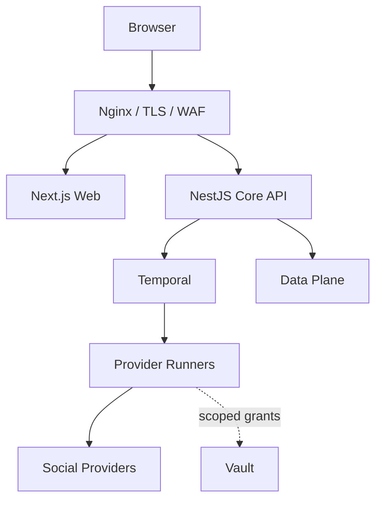

# مدل استقرار و شبکه

> شناسه تصمیم: S03-W02 — وضعیت: پذیرفته‌شده — مقصد Production: `https://srun.ir/mohtavayab`

## دامنه و معیار پذیرش

این مدل توپولوژی منطقی Production، Trust Boundaryها، پروتکل‌های مجاز، Secret Flow، محیط‌ها و بازیابی را تعریف می‌کند. فایل‌های Compose/Kubernetes/Nginx در S04 و S60 پیاده می‌شوند.

معیار پذیرش W02: تنها Edge ورودی عمومی دارد؛ Provider Runner ورودی عمومی و دسترسی مستقیم به Data Plane ندارد؛ مسیر `/mohtavayab` برای UI/API/Asset/OAuth/WebSocket سازگار است؛ noVNC موقت و احراز‌شده است؛ تمام ارتباطات قابل مشاهده و Fail-closed هستند.

## توپولوژی Production

## Zoneها و Trust Boundaryها

| Zone | اجزا | ورودی مجاز | خروجی مجاز |
|---|---|---|---|
| Edge | Nginx، TLS، Rate Limit، WAF | اینترنت 443 | Web/API روی شبکه App |
| Application | Next.js، NestJS، Internal Worker | فقط Edge و شبکه مدیریت | Data، Temporal، OTel، Vault broker |
| Workflow | Temporal Frontend/History/Matching | فقط Core و Workerهای شناخته‌شده | Persistence و Task Queue |
| Provider Execution | Runnerهای جدا برای هر Provider/نسخه | فقط Task Queue و Secret Grant | دامنه‌های Allowlist Provider، URL موقت Media، OTel |
| Data | PostgreSQL، Redis، MinIO، OpenSearch؛ بعداً ClickHouse/Neo4j | فقط سرویس مالک | Backup و Telemetry کنترل‌شده |
| Observability | OTel Collector، Prometheus، Loki، Grafana، Alertmanager | Telemetry پالایش‌شده | داشبورد/اعلان مدیریت |
| Admin | Bastion/VPN، CI/CD Runner | MFA و IP Policy | API مدیریت و Deploy |

Default Deny بین Zoneها اعمال می‌شود. Ruleهای شبکه با شناسهٔ Connectionهای `architecture/system-model.json` هم‌نام هستند.

## مسیرهای ورودی زیر Subpath

| مسیر | مقصد | الزام |
|---|---|---|
| `/mohtavayab` و Assetها | Next.js | `basePath: '/mohtavayab'` در Build |
| `/mohtavayab/api/*` | Core API | Request ID، CSRF/CORS، Body Limit |
| `/mohtavayab/ws/*` | Gateway بلادرنگ | Auth، Origin Check، Idle Timeout |
| `/mohtavayab/oauth/callback/:provider` | Core Callback | State/PKCE، Redirect Allowlist |
| `/mohtavayab/session/:id` | noVNC Gateway | MFA، Consent، TTL، One-time token |
| `/mohtavayab/health/live` | Liveness | بدون جزئیات داخلی |
| `/mohtavayab/health/ready` | Load Balancer داخلی | وابستگی‌های ضروری و Build ID |

`basePath` در Build قفل می‌شود و Nginx نباید با Rewrite مخفی آن را شبیه‌سازی کند. URLهای Public، Callback و Asset از یک `PUBLIC_BASE_URL` معتبر ساخته می‌شوند.

## جریان‌های شبکه مجاز

- Edge → Web/API: HTTP/2 داخلی یا mTLS؛ Header هویت از Client پذیرفته نمی‌شود.
- Core → PostgreSQL/Redis/MinIO/OpenSearch/Temporal/Vault Broker: DNS داخلی، TLS و Service Identity.
- Runner → Provider: فقط HTTPS به Domain/Port ثبت‌شده در Provider Manifest؛ DNS Rebinding و IP خصوصی مسدود.
- Runner → MinIO: فقط Presigned URL محدود به Object Key، Size، MIME، TTL و Method.
- همهٔ سرویس‌ها → OTel Collector: OTLP با Redaction؛ Collector به سرویس‌ها برگشت ندارد.
- Backup Agent از Data Zone به Repository Immutable خروجی دارد؛ Restore فقط با Runbook و Approval.

## noVNC و مرورگر تعاملی

برای Instagram/Providerهای نیازمند ورود وب، Browser Container برای یک Account Lease ساخته می‌شود. Container شبکه، Profile و Volume جدا دارد؛ noVNC مستقیماً Public نیست و Gateway بعد از MFA و Consent یک Token یک‌بارمصرف با حداکثر عمر ۱۵ دقیقه صادر می‌کند. Clipboard، File Upload و Download پیش‌فرض خاموش‌اند؛ Session ضبط محتوایی نمی‌شود و فقط Metadata امنیتی Audit می‌شود. پایان Auth یا TTL باعث Revoke Token، بستن Container و انتقال Session رمز‌شده به Vault می‌شود.

## محیط‌ها

| محیط | داده | اتصال Provider | توپولوژی |
|---|---|---|---|
| Local | Synthetic | Mock/Sandbox پیش‌فرض | Compose تک‌گره |
| Preview | Synthetic per PR | Mock؛ حساب واقعی ممنوع | Ephemeral و TTLدار |
| Staging | Pseudonymized/Test Accounts | Allowlist محدود | مشابه Production با ظرفیت کمتر |
| Production | واقعی و طبقه‌بندی‌شده | Certified Providers | HA، Backup، Alert و Change Control |

هیچ Snapshot Production وارد Local/Preview نمی‌شود. Feature Flag و Provider Kill Switch برای هر محیط مستقل‌اند.

## دسترس‌پذیری، ظرفیت و بازیابی

- Web/API/Runner Stateless و قابل Scale افقی‌اند؛ Affinity فقط برای noVNC Session مجاز است.
- PostgreSQL با PITR، MinIO با Versioning/Object Lock متناسب Policy و OpenSearch با Snapshot اداره می‌شوند.
- هدف اولیه: RPO دادهٔ عملیاتی ۱۵ دقیقه، RTO سرویس حیاتی ۴ ساعت؛ عدد نهایی در S58 با Restore Drill تأیید می‌شود.
- Temporal History و Domain State هر دو Backup می‌شوند، اما Domain Truth فقط PostgreSQL است.
- Queue Lag، Saturation، Error Budget، Storage Growth و Certificate Expiry Alert دارند.
- Load Shedding ابتدا Search/Analytics سنگین، سپس Backfill کم‌اولویت را محدود می‌کند؛ Auth/Publish Receipt و Delete Workflow حفظ می‌شوند.

## شکست و عملیات

| شکست | رفتار ایمن | سیگنال |
|---|---|---|
| Data Store قطع | Readiness قرمز؛ Write رد، بدون Cache-as-truth | dependency/error rate |
| Temporal قطع | درخواست پذیرفته‌نشده یا Pending صریح؛ Job گم نمی‌شود | schedule/task lag |
| Provider اختلال | Circuit Breaker و Backoff؛ Providerهای دیگر مستقل | provider SLO |
| Vault قطع | Grant جدید Fail-closed؛ Secret Cache بلندمدت ممنوع | grant failures |
| Disk/Object quota | Upload متوقف؛ Raw ناقص Commit نمی‌شود | capacity forecast |
| OTel قطع | Buffer محدود؛ سرویس ادامه، Secret هرگز Log نمی‌شود | telemetry drop |
| Egress anomaly | NetworkPolicy Block، Runner quarantine و Incident | denied connection |

## منابع مرجع

- [Next.js `basePath`](https://nextjs.org/docs/app/api-reference/config/next-config-js/basePath)
- [Temporal Documentation](https://docs.temporal.io/)
- [OWASP SSRF Prevention](https://cheatsheetseries.owasp.org/cheatsheets/Server_Side_Request_Forgery_Prevention_Cheat_Sheet.html)
- [OWASP Webhook Security](https://cheatsheetseries.owasp.org/cheatsheets/Webhook_Security_Cheat_Sheet.html)

## معیار پذیرش W02

- Zoneها، Connectionها، Subpath و محیط‌ها مستندند.
- Provider Egress و noVNC کمینه‌اختیار و Fail-closed هستند.
- RPO/RTO اولیه، Failure Matrix و Telemetry تعریف شده‌اند.
- مدل ماشین‌خوان هیچ مسیر Public به Data/Workflow/Runner ایجاد نمی‌کند.
