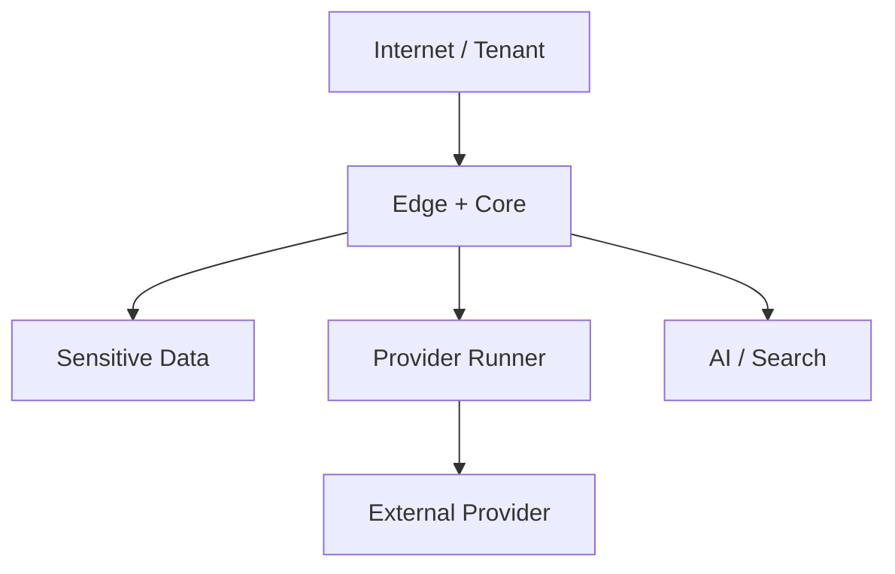

# Threat Model هادی / محتوا‌یاب

> شناسه تصمیم: S03-W04 — روش: STRIDE + Abuse Case — نسخه: 1.0

## دامنه و معیار پذیرش

دارایی‌های در دامنه: حساب و Session شبکه اجتماعی، دادهٔ Tenant، Raw/Canonical Content، رسانه، Workflow، Publish Authority، Export، Audit، AI Context و زیرساخت مدیریت. Threat Model با هر Provider جدید، تغییر Trust Boundary یا Incident بازبینی می‌شود.

معیار پذیرش W04: دارایی، Actor، Boundary و Data Flow مشخص؛ تهدیدهای بحرانی دارای Prevent/Detect/Respond/Owner؛ Risk پذیرفته‌شده صریح؛ و Release Gate امنیتی قابل اجرا باشد.

## بازیگران و مرزهای اعتماد

- User، Workspace Admin، Platform Admin و Support با سطح دسترسی متفاوت.
- Provider رسمی/غیررسمی و SDK/Library شخص ثالث.
- مهاجم اینترنتی، Tenant مخرب، حساب Provider تسخیرشده و Insider.
- محتوای استخراج‌شده و Prompt ورودی **غیرقابل اعتماد** هستند، حتی اگر عمومی باشند.
- Boundaryها: Browser↔Edge، Edge↔Core، Core↔Data، Core↔Temporal، Temporal↔Runner، Runner↔Provider، Core↔AI و Admin↔Production.

## جریان تهدید

## رجیستر تهدیدهای اولویت‌دار

| ID | STRIDE | سناریو | سطح | کنترل کلیدی | تشخیص/پاسخ |
|---|---|---|---|---|---|
| TM-01 | E/I | Tenant Breakout با IDOR/Query ناقص | بحرانی | TenantContext اجباری، RLS، تست منفی | Audit denial، Incident و Freeze Tenant |
| TM-02 | S/I | سرقت Token/Session/OTP | بحرانی | Vault، Grant کوتاه، Redaction، MFA | Secret-use anomaly، Revoke/Rotate |
| TM-03 | E | تصاحب noVNC/Browser Session | بالا | Token یک‌بارمصرف، TTL، Origin/IP Policy، Clipboard off | Session audit، terminate container |
| TM-04 | S/T | Webhook/Callback جعلی یا Replay | بالا | State/PKCE، Signature، nonce/timestamp، idempotency | signature failures، rotate key |
| TM-05 | I/E | SSRF از URL رسانه/Webhook | بحرانی | https allowlist، DNS/IP validation، egress policy | denied egress، quarantine runner |
| TM-06 | T/D | فایل مخرب، Zip Bomb، MIME spoof | بالا | size/type/signature scan، sandbox، object quarantine | scan event، purge artifact |
| TM-07 | T/E | Prompt Injection از پست استخراجی | بالا | content-as-data، tool allowlist، no-secret context، approval | AI policy denial، disable prompt version |
| TM-08 | R/T | انکار عملیات انتشار/ویرایش | بالا | Immutable audit، approval، signed receipt، provenance | reconcile receipt، suspend publish |
| TM-09 | D | Rate Limit exhaustion/Queue flood | بالا | quota، account budget، admission control | lag/budget alert، load shedding |
| TM-10 | T | Publish دوباره بعد از timeout | بحرانی | idempotency، provider lookup، reconcile before retry | duplicate detector، manual rollback |
| TM-11 | I | نشت Secret/PII در Log/Trace/Error | بحرانی | structured allowlist logging، C4 redaction | canary/secret scan، purge with integrity record |
| TM-12 | I | Export انبوه یا دانلود خارج Policy | بالا | RBAC، purpose، step-up auth، watermark/expiry | export volume alert، revoke link |
| TM-13 | E/T | Dependency/Image آلوده | بالا | pin digest، SBOM، signature، SCA، isolated runner | build provenance fail، kill switch |
| TM-14 | I | Graph re-identification یا Merge غلط | بالا | evidence/confidence، least privilege، human undo | merge audit، split/rebuild projection |
| TM-15 | R | حذف ناقص در Projection/Backup | بالا | deletion case/receipt، replay after restore | deletion backlog alert، legal escalation |
| TM-16 | S/E | جعل Provider Capability/Manifest | بالا | signed registry، certification، version pin | contract failure، quarantine version |
| TM-17 | E | سوءاستفاده Support/Admin | بحرانی | JIT access، MFA، dual approval، session audit | privileged access review، revoke |
| TM-18 | I/T | Search injection/XSS از محتوای خام | بالا | output encoding، sanitizer، CSP، query DSL | CSP report، disable content preview |

رجیستر ماشین‌خوان کامل در `architecture/threat-register.json` مالک، کنترل، Residual Risk و Test Evidence را نگه می‌دارد.

## Abuse Caseهای حیاتی

### انتشار بدون اختیار

مهاجم تلاش می‌کند با Replay درخواست، تغییر Destination یا دورزدن Approval پست منتشر کند. Core باید Policy Snapshot، Destination Binding، Content Hash، Approval State و Idempotency Key را پیش از Dispatch دوباره ارزیابی کند. Receipt با Provider Post ID ثبت و Reconcile می‌شود.

### استخراج فراتر از مجوز

Tenant مخرب شناسهٔ Source خصوصی یا Account Tenant دیگر را می‌دهد. Resolver فقط با Account Lease همان Tenant و Purpose ثبت‌شده اجرا می‌شود؛ Forbidden به دادهٔ وجود/عدم‌وجود نشت نمی‌دهد و Enumeration Rate Limited است.

### محتوای آلوده علیه AI یا اپراتور

متن پست حاوی دستور برای افشای Token یا اجرای Tool است. Raw Content هیچ نقش Instruction ندارد؛ AI Gateway فقط Payload حداقلی و Toolهای بدون Secret دریافت می‌کند؛ خروجی High-impact قبل از انتشار Approval می‌خواهد.

## الزامات امنیتی بر اساس Boundary

| Boundary | کنترل پیشگیرانه | Evidence |
|---|---|---|
| Browser→Edge | TLS، CSP، CSRF، secure cookie، rate limit | DAST/header test |
| Edge→Core | trusted proxy list، request ID، body limit | integration test |
| Core→Data | service identity، TLS، RLS، least privilege | tenant isolation test |
| Core→Temporal | namespace/task queue ACL، payload codec | workflow contract test |
| Temporal→Runner | image/version pin، signed task، scoped grant | provider certification |
| Runner→Internet | allowlist، no private IP، timeout/size cap | egress negative test |
| Core→AI | C4 block، prompt version، budget، no auto-publish | AI policy test |
| Admin→Prod | SSO/MFA، JIT، dual approval، bastion | access review |

## ثبت رویداد و Incident

Security Eventها: login risk، permission denial، secret grant/revoke، provider challenge، egress denial، malware hit، export، approval، publish، privileged access، policy change و deletion failure. Logها Structured، tamper-evident و بدون C4 هستند.

Severity بحرانی: Publish غیرمجاز، Cross-tenant access، Secret leak و destructive deletion. پاسخ: Contain با Kill Switch/Revoke، Preserve Evidence، Notify owner/legal، Eradicate، Recover، Reconcile Provider/Data و Post-incident Review. Runbook اجرایی در S10/S57 تکمیل می‌شود.

## Release Gate امنیتی

- هیچ Risk بحرانی باز بدون Owner، Compensating Control و Expiry پذیرفته نیست.
- Provider غیررسمی بدون Risk Label، حساب آزمایشی، Contract Test، Egress Allowlist و Kill Switch به Production نمی‌رود.
- SAST، Secret Scan، Dependency/Image Scan و Tenant Isolation Tests در CI اجباری می‌شوند.
- File Pipeline قبل از نمایش/AI/انتشار Scan و Quarantine دارد.
- Restore Drill باید Deletion Replay و Tenant Isolation را نیز اثبات کند.

## ریسک‌های پذیرفته‌شده فعلی

- APIهای غیررسمی می‌توانند تغییر یا حساب را محدود کنند؛ فقط Pilot و Kill Switch، بدون تضمین Availability.
- Projectionهای Search/Analytics Eventually Consistent هستند؛ UI Freshness را نشان می‌دهد.
- noVNC سطح حمله می‌افزاید؛ تنها برای Provider لازم، زمان‌دار و ایزوله فعال است.

## منابع مرجع

- [OWASP Threat Modeling](https://owasp.org/www-community/Threat_Modeling)
- [OWASP SSRF Prevention](https://cheatsheetseries.owasp.org/cheatsheets/Server_Side_Request_Forgery_Prevention_Cheat_Sheet.html)
- [OWASP File Upload](https://cheatsheetseries.owasp.org/cheatsheets/File_Upload_Cheat_Sheet.html)
- [OWASP Logging](https://cheatsheetseries.owasp.org/cheatsheets/Logging_Cheat_Sheet.html)
- [OWASP RAG Security](https://cheatsheetseries.owasp.org/cheatsheets/RAG_Security_Cheat_Sheet.html)

## معیار پذیرش W04

- ۱۸ تهدید اولویت‌دار و تمام Trust Boundaryها پوشش داده شده‌اند.
- Threatهای بحرانی Prevent/Detect/Respond دارند.
- Release Gate، Incident و Residual Risk صریح است.
- `architecture/threat-register.json` با Validator استیج کنترل می‌شود.
