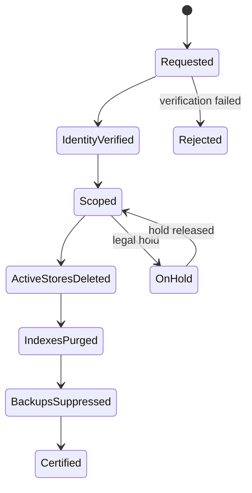

# نگهداری، حذف، Export و Legal Hold

شناسه تحویل: `S02-W04`  
نسخه: `1.0.0`

## اصل اجرای Policy

مدت مؤثر برای هر رکورد برابر سخت‌گیرانه‌ترین محدودیت معتبر است:

```text
effective_retention = min(workspace_policy, provider_policy, consent_expiry, legal_profile)
```

`legal_hold` فقط با دلیل، مرجع، Scope، مالک، تاریخ بازبینی و Audit می‌تواند حذف را متوقف کند. Hold مبهم یا دائمی مجاز نیست.

## پیش‌فرض‌های محصول

| داده | پیش‌فرض | پایان/محرک | رفتار |
|---|---:|---|---|
| OTP و challenge value | حداکثر ۱۰ دقیقه | مصرف/انقضا | حذف فوری، بدون Log |
| browser auth container | حداکثر ۲۴ ساعت | پایان/خطا | Destroy volume و session temp |
| Provider token/session | تا revoke/expiry | revoke، scope change | Vault delete/rotate و توقف Job |
| transfer temp cache | ۲۴ ساعت | Receipt نهایی | حذف Object موقت |
| Export artifact | ۷ روز | download/expiry | حذف Object و signed URL |
| application log | ۳۰ روز | rolling expiry | redact و purge |
| security log | ۹۰ روز | rolling expiry | دسترسی Security فقط |
| Audit event | ۴۰۰ روز | expiry/legal hold | append-only، حداقل محتوا |
| content metadata | ۹۰ روز پیش‌فرض | Workspace/provider rule | purge یا archive مصوب |
| cached media | ۳۰ روز پیش‌فرض | Workspace/provider rule | delete/refresh |
| analytics aggregate | ۲۵ ماه | expiry | فقط aggregate/de-identified |
| backup | ۳۵ روز | rotation | encrypted expiry؛ suppression پس از restore |

این مقادیر baseline هستند؛ Provider profile می‌تواند کوتاه‌تر باشد و قرارداد/قانون محلی نیازمند تأیید حقوقی است.

## Deletion Workflow



### ترتیب اجرا

1. ثبت درخواست و Correlation ID؛
2. احراز هویت/اختیار درخواست‌کننده؛
3. Resolve کردن Subject، Workspace، Provider و مشتقات؛
4. توقف Watch/Publish و revoke access؛
5. حذف/ناشناس‌سازی PostgreSQL؛
6. purge از OpenSearch، ClickHouse و Neo4j؛
7. حذف Object/thumbnail/export در MinIO/S3؛
8. پاک‌سازی Cache/Queue و جلوگیری از replay؛
9. ثبت backup suppression marker؛ پس از Restore دوباره deletion replay می‌شود؛
10. تولید گواهی بدون افشای داده حذف‌شده.

## Deadline Engine

`due_at` از کمترین مهلت قانون، Provider و SLA داخلی ساخته می‌شود. نمونه:

- YouTube user data request: حداکثر ۷ روز طبق policy جاری؛
- YouTube refresh/delete بسیاری از API Data: ۳۰ روز؛
- Pinterest deletion trigger: بدون تأخیر و حداکثر ۳۰ روز؛
- X/Meta: deadline از Provider Policy Profile جاری خوانده می‌شود؛
- درخواست عمومی موضوع داده: هدف داخلی ۳۰ روز مگر قانون کوتاه‌تر.

Deadlineها در کد ثابت نمی‌شوند؛ Profile نسخه‌دار و Terms Monitor منبع آن‌هاست.

## Export Workflow

- Scope و هدف درخواست نمایش داده می‌شود.
- هویت و Permission درخواست‌کننده بررسی می‌شود.
- Secret، credential، internal risk score و داده خارج Scope حذف می‌شوند.
- قالب‌ها: JSONL برای portability، CSV/XLSX برای جدول، ZIP manifest برای media.
- هر فایل manifest، schema version، timezone، checksum، provenance و زمان انقضا دارد.
- Export با کلید کوتاه‌عمر رمزگذاری و لینک دانلود single-use ارائه می‌شود.
- دانلود، شکست و انقضا Audit می‌شوند.

## نمونه Export Manifest

```json
{
  "export_id": "uuid",
  "workspace_id": "uuid",
  "requester_id": "uuid",
  "scope": ["content", "media_metadata", "receipts"],
  "excluded": ["secrets", "session_data", "internal_risk_signals"],
  "schema_version": "1.0.0",
  "created_at": "ISO-8601",
  "expires_at": "ISO-8601",
  "files": [{"name": "content.jsonl", "sha256": "..."}]
}
```

## حذف Workspace

حذف Workspace دو مرحله‌ای است: درخواست و تأیید قوی، سپس grace period قابل تنظیم. در grace period Job/Publish متوقف و Workspace read-only می‌شود. پس از شروع purge بازگشت عادی ممکن نیست. Owner گزارش Scope و پیامد backup را پیش از تأیید می‌بیند.

## Backup و حذف

ویرایش درون backup immutable توصیه نمی‌شود. Backup با مدت کوتاه و encryption جدا نگهداری می‌شود؛ شناسه‌های حذف در suppression ledger ثبت و هر Restore پیش از بازگشت سرویس، deletion replay می‌کند. پس از expiry، کلید/نسخه backup حذف می‌شود.

## کنترل خطا

- حذف ناقص → `partial`، retry و alert؛ گواهی صادر نمی‌شود.
- Store در دسترس نیست → deadline alert و escalation.
- Legal hold → داده از استفاده عادی خارج، فقط custodian مجاز.
- Provider deletion event بدون رکورد → tombstone ساخته می‌شود تا ingest مجدد مسدود شود.
- Export بزرگ → chunk/resume و سقف؛ فایل ناقص منتشر نمی‌شود.

## معیار پذیرش W04

- baseline، override و فرمول retention روشن است.
- حذف به همه Storeها، Indexها، Objectها و Restore propagation می‌رسد.
- Export، Secret و داده خارج Scope را حذف می‌کند.
- deadline engine Provider-aware و نسخه‌دار است.
- Legal hold و deletion certificate قابل ممیزی‌اند.

## منابع رسمی

- GDPR Right to Erasure و Data Portability: https://eur-lex.europa.eu/eli/reg/2016/679/oj
- YouTube API Developer Policies: https://developers.google.com/youtube/terms/developer-policies
- Pinterest Developer Terms، بخش Data Deletion: https://developers.pinterest.com/terms/
- Meta Platform Terms، Retention/Deletion: https://developers.facebook.com/terms
- X Developer Policy: https://t.co/devpolicy

