# بک‌لاگ و سیاست اولویت‌بندی

شناسه تحویل: `S01-W04`  
نسخه: `1.0.0`

## مدل اولویت‌بندی

ابتدا قیود غیرقابل مذاکره اعمال می‌شوند: Tenant isolation، Secret safety، قابلیت Resume، Idempotency، Audit و Provider Contract. سپس قابلیت‌ها با WSJF سبک امتیاز می‌گیرند:

```text
WSJF = (ارزش کسب‌وکار + فوریت زمانی + کاهش ریسک/ایجاد فرصت) / اندازه کار
```

هر مولفه از ۱ تا ۱۰ است. امتیاز بالا مجوز عبور از Security/Legal gate نیست.

## کلاس‌های اولویت

- **P0 Foundation:** نبود آن توسعه بعدی را ناامن یا دوباره‌کاری می‌کند.
- **P1 MVP:** برای پایلوت انتهابه‌انتها لازم است.
- **P2 Expansion:** Provider یا قابلیت گسترشی پس از تثبیت مسیر اصلی.
- **P3 Optimization:** بهینه‌سازی و تجربه پیشرفته پس از وجود داده واقعی.

## Critical Path

```mermaid
flowchart LR
  S01[S01 محصول] --> S02[S02 حقوق]
  S02 --> S03[S03 معماری]
  S03 --> S04[S04 Monorepo]
  S04 --> S08[S08 Provider Contract]
  S08 --> S16[S16 Canonical Model]
  S16 --> S18[S18 Cursor/Idempotency]
  S18 --> S21[S21 Telegram]
  S21 --> S36[S36 Persian Search]
  S36 --> S39[S39 Collection]
  S39 --> S47[S47 Transfer]
  S47 --> S59[S59 Pilot]
  S59 --> S60[S60 Launch]
```



## بک‌لاگ اولویت‌دار

| رتبه | قابلیت | Stage | ارزش | فوریت | ریسک/فرصت | اندازه | WSJF | کلاس |
|---:|---|---|---:|---:|---:|---:|---:|---|
| 1 | Provider Contract و Contract Test | S08 | 10 | 10 | 10 | 3 | 10.0 | P0 |
| 2 | Tenant isolation و RBAC | S07 | 10 | 10 | 10 | 4 | 7.5 | P0 |
| 3 | Cursor/Checkpoint/Idempotency | S18 | 10 | 9 | 10 | 4 | 7.25 | P0 |
| 4 | Canonical Content Model | S16 | 10 | 9 | 9 | 4 | 7.0 | P0 |
| 5 | Secret/Session/noVNC isolation | S12 | 9 | 10 | 9 | 4 | 7.0 | P0 |
| 6 | Temporal Workflow و Recovery | S09 | 9 | 9 | 10 | 4 | 7.0 | P0 |
| 7 | Account Pool/Lease/Budget | S13 | 9 | 9 | 9 | 4 | 6.75 | P0 |
| 8 | Extraction Job/Backfill | S17 | 10 | 9 | 7 | 4 | 6.5 | P1 |
| 9 | Content Library | S20 | 10 | 9 | 6 | 4 | 6.25 | P1 |
| 10 | Telegram Provider | S21 | 10 | 9 | 7 | 5 | 5.2 | P1 |
| 11 | Instagram Provider | S22 | 10 | 9 | 8 | 6 | 4.5 | P1 |
| 12 | Eitaa Provider | S23 | 9 | 9 | 8 | 6 | 4.33 | P1 |
| 13 | Bale Provider | S24 | 8 | 8 | 8 | 6 | 4.0 | P1 |
| 14 | Persian Search | S36-S37 | 10 | 8 | 6 | 6 | 4.0 | P1 |
| 15 | Collection | S39 | 9 | 8 | 5 | 4 | 5.5 | P1 |
| 16 | Rule Filter/Sanitize | S41 | 9 | 8 | 7 | 4 | 6.0 | P1 |
| 17 | Transfer Engine | S47 | 10 | 9 | 8 | 6 | 4.5 | P1 |
| 18 | Calendar و Receipt | S49-S50 | 9 | 8 | 7 | 6 | 4.0 | P1 |
| 19 | Trend پایه | S51-S52 | 7 | 6 | 4 | 5 | 3.4 | P2 |
| 20 | Graph و Entity Resolution | S54-S55 | 5 | 3 | 5 | 8 | 1.63 | P3 |

## برش‌های تحویل

### Slice A ـ Foundation قابل اعتماد

S01 تا S18 با Auth، Tenancy، Provider Contract، Account، Storage، Workflow و Canonical Model. خروجی: اجرای مصنوعی Provider و Recovery قابل اثبات.

### Slice B ـ استخراج واقعی

S19 تا S25. خروجی: چهار Provider MVP و تلوبیون، Library واقعی، همه انواع رسانه اعلام‌شده و Watch.

### Slice C ـ پیدا کردن و انتخاب

S36 تا S40. خروجی: جست‌وجوی فارسی، Saved Search، Collection و Download/Provenance.

### Slice D ـ آماده‌سازی و انتشار

S41 تا S50. خروجی: Rule/AI/Approval، Transfer، Calendar و Receipt.

### Slice E ـ تحلیل و عرضه

S51 تا S60. خروجی: Trend پایه، رقبا، Graph اختیاری، Hardening، Pilot و Production.

## Now / Next / Later

| افق | محتوا | شرط خروج |
|---|---|---|
| Now | S01-S10 | Contract و Threat Model قفل، CI و Observability آماده |
| Next | S11-S25 | مسیر Account→Source→Backfill→Library روی Provider واقعی |
| Then | S36-S50 | Search→Collection→Rule→Transfer→Receipt |
| Later | S26-S35 و S51-S55 | Expansion و Analytics بر اساس تقاضا و کیفیت داده |
| Launch | S56-S60 | Load، Pentest، Restore، Pilot و Go/No-Go |

Providerهای S26-S35 می‌توانند پس از تثبیت S08/S13/S16/S18 موازی شوند و نباید Critical Path MVP را متوقف کنند.

## سیاست تغییر دامنه

درخواست جدید فقط با پاسخ به این پرسش‌ها وارد Stage می‌شود:

1. به کدام JTBD و KPI کمک می‌کند؟
2. Provider/Permission/Legal gate آن چیست؟
3. وابستگی و هزینه نگهداری آن چیست؟
4. چه چیزی برای ورود آن از Scope خارج می‌شود؟
5. آیا می‌توان آن را به تسک حداکثر دو نفر-روز شکست؟

تغییر P0/P1 نیازمند ADR یا Product Decision Record و به‌روزرسانی Roadmap است.

## Release Gate MVP

- چهار Provider اول Contract Test و Media Matrix را پاس کرده‌اند.
- قطع Worker باعث Cursor loss یا Duplicate نمی‌شود.
- هر محتوا Provider، Source، External ID و Permalink معتبر دارد.
- جست‌وجوی فارسی و Collection سه‌Provider قابل استفاده است.
- Raw immutable و Rule/Approval قابل ممیزی است.
- شکست یک مقصد مانع مقصدهای دیگر نیست و Receipt مستقل ثبت می‌شود.
- Tenant isolation، Secret scan، Backup و Restore آزمایش شده‌اند.

## معیار پذیرش W04

- روش امتیازدهی و کلاس‌های اولویت روشن‌اند.
- Critical Path با وابستگی Roadmap سازگار است.
- MVP به Sliceهای قابل دمو شکسته شده است.
- Provider expansion از مسیر بحرانی جدا شده است.
- Change control و Release Gate قابل اجرا هستند.

