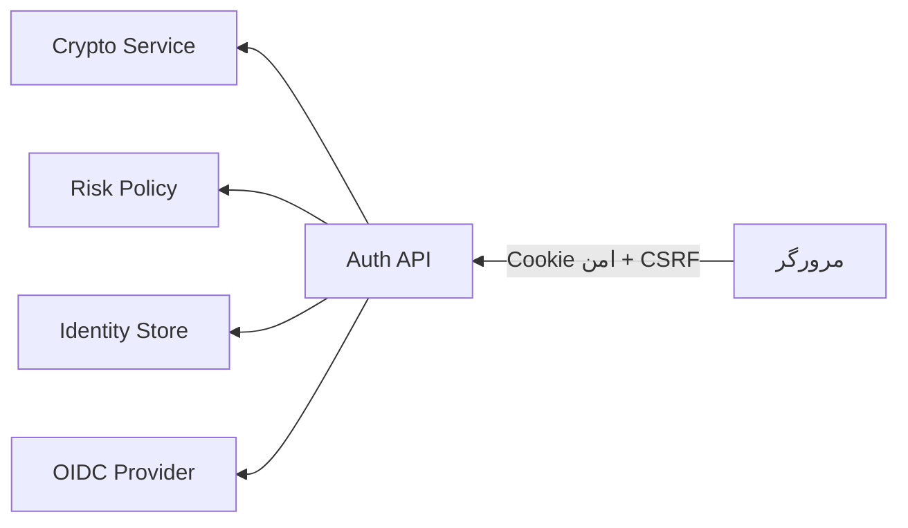

# معماری احراز هویت هادی

## دامنه S06

هویت کاربر مستقل از Workspace ساخته می‌شود و S07 ارتباط آن را با Membership و RBAC برقرار کرده است. API ثبت‌نام، ورود، Refresh، خروج، MFA، بازیابی، نشست‌ها و OIDC در `apps/api/src/auth` قرار دارد. AuthStore اکنون در حالت `AUTH_STORE_DRIVER=postgres` کاربران، MFA، نشست‌ها، بازیابی و OIDC را در PostgreSQL نگهداری و هنگام آغاز بازیابی می‌کند؛ حالت درون‌حافظه‌ای فقط برای تست و توسعه سریع باقی مانده است.

## مرزهای اعتماد

مرورگر هرگز Access Token یا Refresh Token را در Local Storage نمی‌گذارد. Cookieهای نشست در Production با `HttpOnly`، `Secure`، `SameSite=Lax` و `Path=/` صادر می‌شوند. Device ID تصادفی، اعتبار احراز هویت نیست و تنها سیگنال ریسک است.

## رمز عبور و رازها

- Argon2id با ۱۹ MiB حافظه، دو Iteration و یک Lane؛
- Salt توسط کتابخانه و Pepper از Secret Store؛
- Refresh Token و Reset Token فقط به‌شکل HMAC ذخیره می‌شوند؛
- راز TOTP با AES-256-GCM و کلید مستقل رمز می‌شود؛
- مقدار OTP، رمز عبور، توکن خام و IP خام وارد Audit نمی‌شوند.

## قراردادهای خطا

پیام ورود ناموفق برای ایمیل موجود و ناموجود یکسان است. بازیابی رمز همیشه `accepted: true` برمی‌گرداند تا وجود حساب افشا نشود. کدهای داخلی استاندارد شامل `invalid_credentials`، `invalid_mfa`، `invalid_session`، `refresh_reuse_detected` و `rate_limited` هستند.

سیاست ماشین‌خوان در `security/identity-policy.json` و قراردادهای ورودی/خروجی در `packages/contracts` نگهداری می‌شوند.
